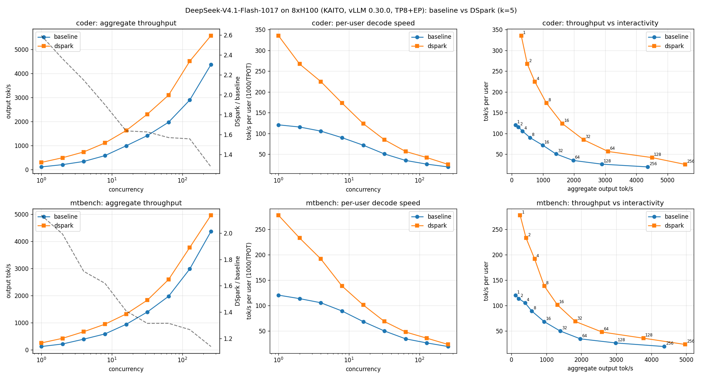
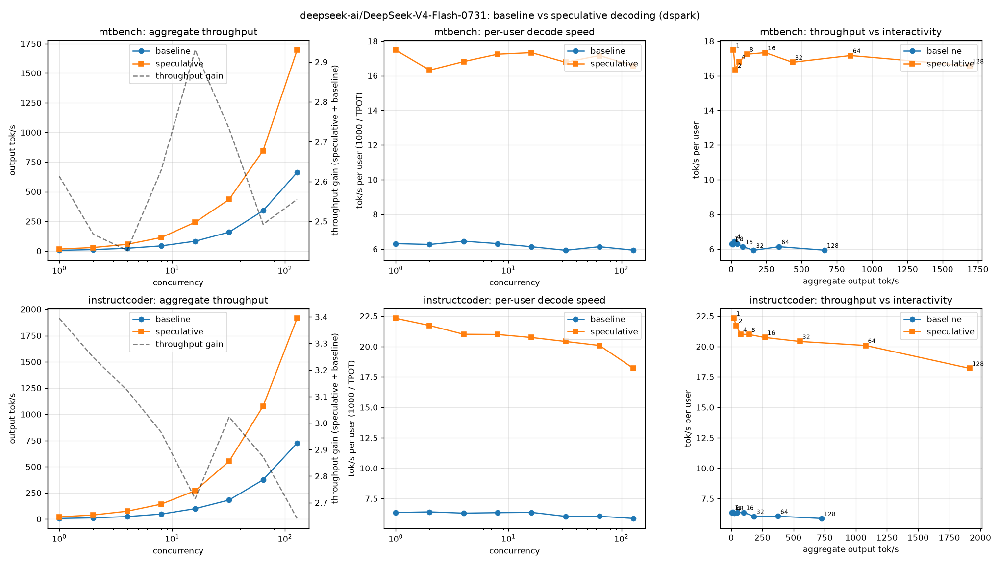

# DSpark speculative decoding on DeepSeek V4 Flash models (2026-11-02)

This report summarizes how much [DSpark](https://recipes.vllm.ai/deepseek-ai/DeepSeek-V4.1-Flash?features=tool_calling%2Creasoning%2Cspec_decoding&frontend=python) speculative decoding helps two KAITO presets at concurrency from 1 to 256:

- `deepseek-ai/DeepSeek-V4.1-Flash-1017`
- `deepseek-ai/DeepSeek-V4-Flash-0731`

## Summary

| Model | Node | Throughput gain, MT-Bench (c=1 → c=max) | Throughput gain, InstructCoder (c=1 → c=max) |
|---|---|---|---|
| V4.1-Flash-1017 | 8×H100 (`Standard_ND96isr_H100_v5`) | 2.14× → 1.14× (c=256) | 2.59× → 1.28× (c=256) |
| V4-Flash-0731 | 8×H100 (`Standard_ND96isr_H100_v5`) | 2.61× → 2.55× (c=128) | 3.39× → 2.64× (c=128) |

- **DSpark beat the baseline at every load tested.** Code editing (InstructCoder) benefits more than chat (MT-Bench) because more draft tokens are accepted: about 3.5–3.8 versus 2.9 tokens per step at low load.
- **For V4.1-Flash, the gain shrinks with load.** Larger batches leave less spare compute for verifying drafts, and adaptive verification checks fewer draft tokens as the batch fills.
- **For V4-Flash, the gain holds at high load.** On 8×H100 the gain holds at about 2.6× even at concurrency 128, while retaining the full 1M-token context.

## Configuration shipped in the presets

| Preset | `--speculative-config` | Extra engine args when DSpark is on |
|---|---|---|
| `deepseek-ai/DeepSeek-V4.1-Flash-1017` | `{"method":"dspark","num_speculative_tokens":5,"draft_sample_method":"probabilistic","rejection_sample_method":"block","enable_adaptive_verification":true}` (adaptive verification is turned off under pipeline parallelism) | `--max-num-batched-tokens=4096 --max-num-seqs=256 --max-cudagraph-capture-size=1024` |
| `deepseek-ai/DeepSeek-V4-Flash-0731` | `{"method":"dspark","num_speculative_tokens":7,"draft_sample_method":"probabilistic"}` | None |

Both configs follow the model's vLLM recipe. The extra engine args apply only when speculative decoding is injected. The baselines therefore ran with KAITO's and vLLM's defaults, except where noted below.

## Common method

- **Serving:** KAITO Workspace with the preset, on one node, with vLLM 0.30.0. The same Workspace and node served both variants, toggled with the annotation.
- **Client:** `vllm bench serve` in a CPU-only pod on the server's node, sending chat requests through the KAITO service.
- **Datasets:**
  - MT-Bench (`philschmid/mt-bench`): multi-turn chat across 8 categories.
  - InstructCoder (`likaixin/InstructCoder`): code editing.
  - The models' default thinking mode was left on.
- **Load:** closed loop with `max(16, 4 × concurrency)` requests per level.
- **Metrics:**
  - Throughput gain = speculative ÷ baseline output tokens per second.
  - Decode speedup = baseline ÷ speculative mean time per output token (TPOT).

## DeepSeek-V4.1-Flash-1017 on 8×H100

- **Setup:**
  - Parallelism: TP8 with expert parallelism and `FULL_DECODE_ONLY` CUDA graphs.
  - Model: Engram CPU offload on.
  - Both variants used `--max-num-batched-tokens=4096 --max-num-seqs=256 --max-cudagraph-capture-size=1024`, so the comparison is like for like.
- **Sampling:** this run predates the CLI. It used a custom sweep with `temperature=1.0`, `top_p=0.95`, `max_tokens=1024` and seed 42.

| Concurrency | MT-Bench tok/s (base → DSpark) | Gain | Decode speedup | InstructCoder tok/s (base → DSpark) | Gain | Decode speedup |
|---:|---:|---:|---:|---:|---:|---:|
| 1 | 117 → 249 | **2.14×** | 2.31× | 116 → 302 | **2.59×** | 2.78× |
| 2 | 210 → 419 | **1.99×** | 2.05× | 210 → 497 | **2.36×** | 2.32× |
| 4 | 388 → 663 | **1.71×** | 1.82× | 343 → 737 | **2.15×** | 2.13× |
| 8 | 581 → 941 | **1.62×** | 1.55× | 585 → 1111 | **1.90×** | 1.93× |
| 16 | 936 → 1318 | **1.41×** | 1.48× | 993 → 1625 | **1.64×** | 1.73× |
| 32 | 1392 → 1829 | **1.31×** | 1.38× | 1418 → 2306 | **1.63×** | 1.68× |
| 64 | 1971 → 2590 | **1.31×** | 1.39× | 1972 → 3096 | **1.57×** | 1.62× |
| 128 | 2982 → 3775 | **1.27×** | 1.36× | 2894 → 4506 | **1.56×** | 1.61× |
| 256 | 4366 → 4967 | **1.14×** | 1.21× | 4368 → 5570 | **1.28×** | 1.31× |

- **Acceptance:** about 2.9 tokens per step (MT-Bench) and 3.5 (InstructCoder) at c=1, falling to 2.2 and 3.1 at c=256.
- **Time to first token:** essentially unchanged at low load; DSpark adds 20–100 ms to the median at c=32–64.
- **Memory cost:** DSpark's KV pool is about 10× smaller than the baseline's (1.39M vs 13.58M tokens). Most of the difference is memory held by adaptive verification's profiling runs. This didn't limit these short-prompt workloads, but long contexts at high concurrency could.

## DeepSeek-V4-Flash-0731 on 8×H100

- **Setup:**
  - Parallelism: TP8 with expert parallelism and no CUDA graphs.
  - **Memory setting:** both variants used `gpu-memory-utilization: 0.80` through the Workspace inference config.

| Concurrency | MT-Bench tok/s (base → DSpark) | Gain | Decode speedup | InstructCoder tok/s (base → DSpark) | Gain | Decode speedup |
|---:|---:|---:|---:|---:|---:|---:|
| 1 | 6 → 16 | **2.61×** | 2.77× | 6 → 22 | **3.39×** | 3.51× |
| 2 | 12 → 30 | **2.47×** | 2.61× | 12 → 40 | **3.25×** | 3.39× |
| 4 | 23 → 56 | **2.43×** | 2.60× | 24 → 76 | **3.12×** | 3.33× |
| 8 | 43 → 114 | **2.63×** | 2.73× | 48 → 143 | **2.96×** | 3.31× |
| 16 | 83 → 242 | **2.93×** | 2.82× | 100 → 271 | **2.71×** | 3.26× |
| 32 | 159 → 435 | **2.73×** | 2.83× | 182 → 551 | **3.02×** | 3.38× |
| 64 | 340 → 847 | **2.49×** | 2.80× | 375 → 1077 | **2.87×** | 3.32× |
| 128 | 663 → 1694 | **2.55×** | 2.79× | 725 → 1915 | **2.64×** | 3.10× |

- **Acceptance:** about 2.7–3.0 tokens per step on MT-Bench and 3.6–3.8 on InstructCoder, steady across load.
- **Memory:** KV cache was 39.31 GiB per GPU (4.10M tokens) for the baseline and 33.21 GiB (3.46M tokens) with DSpark. Both kept the full 1M-token context.
- **Time to first token:** DSpark adds about 165 ms at c=1 and has no meaningful effect above that.
- **Startup benchmark:** on KAITO's startup benchmark DSpark scored lower than the baseline (105K vs 142K tokens/min). That benchmark uses random prompts, which drafts rarely match, so it doesn't reflect real traffic.
