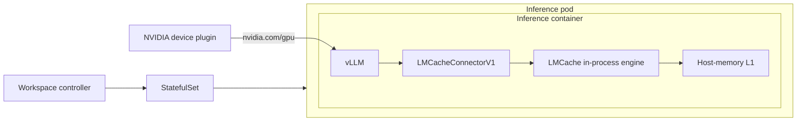
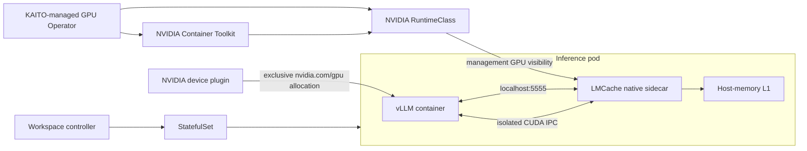

# LMCache MP Sidecar Migration

## Table of Contents

- [LMCache MP Sidecar Migration](#lmcache-mp-sidecar-migration)
  - [Table of Contents](#table-of-contents)
  - [Glossary](#glossary)
  - [Summary](#summary)
  - [Motivation](#motivation)
  - [Proposal](#proposal)
    - [Architectural Changes](#architectural-changes)
    - [Base Image and Inference Runtime](#base-image-and-inference-runtime)
    - [NVIDIA Runtime Stack](#nvidia-runtime-stack)
    - [Workspace Controller](#workspace-controller)
    - [Workspace Pod Template](#workspace-pod-template)
    - [Runtime Configuration and Sizing](#runtime-configuration-and-sizing)
    - [Lifecycle and Readiness](#lifecycle-and-readiness)
    - [Base Image Auto-Upgrade](#base-image-auto-upgrade)
    - [Eligibility Policy](#eligibility-policy)
    - [Observability](#observability)
    - [Security Boundaries](#security-boundaries)
  - [Alternatives](#alternatives)
    - [Sidecar and DaemonSet Comparison](#sidecar-and-daemonset-comparison)
    - [LMCache Kubernetes Operator](#lmcache-kubernetes-operator)

## Glossary

| Term | Meaning |
| --- | --- |
| **Deprecated in-process mode** | KAITO's existing LMCache integration, in which vLLM loads `LMCacheConnectorV1` and LMCache runs inside the vLLM process. It is retained only for migration measurements and is not a supported fallback. |
| **Sidecar mode** | The proposed deployment in which a native Kubernetes sidecar runs `lmcache server` in the same pod as vLLM. |
| **DaemonSet mode** | An alternative deployment with one node-level `lmcache server` shared by vLLM pods scheduled on that node. |
| **Management GPU visibility** | NVIDIA runtime access that lets LMCache enumerate and open CUDA IPC handles for node GPUs without consuming an additional `nvidia.com/gpu` allocation. |
| **Native sidecar** | An init container with `restartPolicy: Always`; Kubernetes starts it before regular containers and keeps it running for the pod lifetime. |
| **L1** | LMCache's host-memory KV cache tier. |

## Summary

This proposal migrates KAITO's existing KV-cache offloading integration from
in-process LMCache via `LMCacheConnectorV1` to multiprocess LMCache via
`LMCacheMPConnector`, with `lmcache server` running as a native Kubernetes
sidecar. The migration bumps LMCache from `0.5.2` to `0.5.5`, enables isolated
IPC, and uses the same pinned `kaito-base` image for the server and vLLM
connector to preserve wire compatibility.

The Workspace controller enables sidecar mode automatically for compatible
Workspaces. KAITO installs a pinned NVIDIA runtime stack by default so the
`RuntimeClass` named `nvidia` is backed by a real containerd runtime handler, not
just a Kubernetes object. The runtime grants the sidecar management visibility
to the same physical GPU devices used by vLLM without making a second
schedulable GPU allocation. If the workload or runtime stack is incompatible,
the controller creates the inference workload without KAITO-managed LMCache and
records the reason. It never falls back to the deprecated in-process connector.

This design follows LMCache's documented
[Kubernetes MP deployment](https://docs.lmcache.ai/mp/deployment.html), which
uses NVIDIA management visibility without a device-plugin GPU claim.

## Motivation

KAITO's existing LMCache integration uses the deprecated
`LMCacheConnectorV1`, which runs LMCache inside the vLLM process. That has no
separate service lifecycle or resource boundary:

- logs and lifecycle are mixed;
- LMCache cannot be probed or restarted independently;
- resource usage cannot be attributed to a distinct container; and
- future LMCache configuration and observability changes require modifying the
  inference wrapper.

A native sidecar gives LMCache an explicit Kubernetes lifecycle and resource
boundary while retaining per-Workspace ownership. A node-wide DaemonSet offers
different benefits, especially cache sharing and persistence across vLLM pod
restarts. This proposal compares both topologies and selects sidecar mode for the
initial migration because KAITO commonly provisions a dedicated node or node
pool for a Workspace, and the existing L1 size and configuration are resolved
per inference workload.

## Proposal

### Architectural Changes

KAITO's current integration loads deprecated `LMCacheConnectorV1` inside the
vLLM process.

**Current architecture**



LMCache runs inside the inference container and shares vLLM's process,
lifecycle, GPU visibility, logs, and resource boundary.

**Proposed architecture**



The Workspace controller owns both containers as one pod template. Only vLLM
claims schedulable GPUs; the sidecar receives management visibility through the
NVIDIA RuntimeClass and owns the LMCache server lifecycle, health, metrics, and
L1 allocation.

This proposal changes the following KAITO components:

- **Base image and inference runtime:** bump LMCache from `0.5.2` to `0.5.5`,
  add `lmcache_server.py`, remove the KAITO-managed `LMCacheConnectorV1` path,
  and load LMCache's external `LMCacheMPConnector` with isolated IPC.
- **NVIDIA runtime stack:** install a pinned GPU Operator release that configures
  Container Toolkit, the `nvidia` runtime handler and RuntimeClass, device
  discovery, and the device plugin.
- **Workspace controller:** evaluate workload and cluster compatibility, inject
  the sidecar automatically when supported, and otherwise disable
  KAITO-managed LMCache without falling back.
- **Workspace pod template:** add `lmcache server` as a native Kubernetes
  sidecar while keeping the inference container as the only `nvidia.com/gpu`
  consumer.
- **Runtime configuration and sizing:** share configuration parsing and preserve
  the existing CPU-memory utilization and per-TP L1 sizing.
- **Lifecycle and readiness:** gate vLLM startup on sidecar health and coordinate
  vLLM restart when LMCache loses CUDA IPC registrations.
- **Eligibility policy:** preserve model and topology exclusions and never fall
  back to deprecated in-process mode.
- **Observability:** expose independent LMCache logs, health, and MP metrics.
- **Security boundaries:** restrict management GPU visibility to dedicated KAITO
  nodes and cluster-operator configuration.

### Base Image and Inference Runtime

KAITO upgrades LMCache to `0.5.5`, the first stable release that ships isolated
IPC and makes it the MP default. Both containers use the same pinned
`kaito-base` image so the connector and server cannot drift independently.

The inference runtime removes the KAITO-managed `LMCacheConnectorV1` path. Since
vLLM `0.25.1` otherwise resolves `LMCacheMPConnector` to its bundled
implementation, KAITO explicitly selects the connector shipped by LMCache:

```json
{
  "kv_connector": "LMCacheMPConnector",
  "kv_connector_module_path": "lmcache.integration.vllm.lmcache_mp_connector",
  "kv_role": "kv_both",
  "kv_connector_extra_config": {
    "lmcache.mp.isolated_ipc": true
  }
}
```

LMCache MP has two cross-process IPC paths: registering vLLM's GPU KV-cache
memory with the server, and ordering each STORE or RETRIEVE operation with GPU
events. Legacy mode uses PyTorch storage IPC for memory registration and CUDA
interprocess events for ordering; both depend on vLLM and LMCache seeing the
same `/dev/shm` filesystem.

Isolated IPC replaces those mechanisms with raw CUDA IPC memory handles and
timeline-semaphore events. The handles rendezvous through the NVIDIA driver, so
the containers do not need a shared IPC namespace or `/dev/shm` volume. This
preserves the sidecar's container boundary, avoids `hostIPC` and shared-memory
mount coupling, and keeps the pod template independent of host IPC settings.
It does not provide GPU access: the sidecar still needs management visibility
to the same physical GPUs through the NVIDIA RuntimeClass.

The server receives `--isolated-ipc` and the connector receives
`"lmcache.mp.isolated_ipc": true` in the same pod-template update. The isolated
and legacy event handles are incompatible, so KAITO must never enable the mode
on only one side. vLLM may retain its pod-private `dshm` mount for its own
workers; the sidecar does not mount it.

### NVIDIA Runtime Stack

A RuntimeClass object only names a container-runtime handler; it does not install
or configure that handler on nodes. Creating `RuntimeClass/nvidia` without the
NVIDIA Container Toolkit would make the controller treat the cluster as
compatible while pods fail during sandbox creation. KAITO therefore installs
the complete runtime integration, not a standalone RuntimeClass manifest.

The KAITO installation workflow deploys a separate, pinned
[NVIDIA GPU Operator](https://docs.nvidia.com/datacenter/cloud-native/gpu-operator/latest/getting-started.html)
Helm release in the dedicated `gpu-operator` namespace before installing the
workspace chart. The initial version is `v26.7.0`. This remains separate from
the workspace chart because GPU Operator requires privileged namespace policy
and cluster-scoped ownership. KAITO uses the classic runtime path required by
this proposal:

- Container Toolkit and the `nvidia` containerd handler are enabled;
- RuntimeClass `nvidia`, the NVIDIA device plugin, NFD, and GFD are managed by
  GPU Operator;
- CDI is disabled for this initial RuntimeClass-based design; and
- NVIDIA driver installation is disabled on managed KAITO node images, which
  already include a supported driver.

The managed release uses these pinned settings:

```yaml
driver:
  enabled: false
toolkit:
  enabled: true
cdi:
  enabled: false
devicePlugin:
  enabled: true
nfd:
  enabled: true
```

When KAITO manages GPU Operator, the workspace chart disables its existing
standalone NVIDIA device-plugin DaemonSet and `gpu-feature-discovery` subchart to
avoid duplicate resources and CRD ownership conflicts. Runtime installation is
cluster-scoped and privileged, so it remains separate from tenant-controlled
Workspace and InferenceSet APIs.

Clusters with an existing GPU Operator installation use the external-runtime
installation profile. The installer verifies that the existing `ClusterPolicy`
is Ready and that RuntimeClass `nvidia` exists, then skips the KAITO-managed GPU
Operator release. It fails installation on a partial or conflicting stack
rather than installing a second operator.

### Workspace Controller

No Workspace, InferenceSet, controller-flag, or dedicated Helm-value change is
required. The Workspace controller owns a single eligibility decision used by
both standalone Workspaces and InferenceSets:

| Condition | Controller behavior |
| --- | --- |
| All workload and cluster checks pass | Inject the sidecar and configure `LMCacheMPConnector`. |
| CPU KV offloading utilization is zero | Create the inference workload without KAITO-managed LMCache. |
| Model or execution topology is unsupported | Create the inference workload without KAITO-managed LMCache. |
| Kubernetes native sidecars are unsupported | Create the inference workload without KAITO-managed LMCache. |
| GPU Operator `ClusterPolicy` is not Ready | Create the inference workload without KAITO-managed LMCache. |
| RuntimeClass `nvidia` is absent | Create the inference workload without KAITO-managed LMCache. |

The controller records the disablement reason in the Workspace status and emits
a Kubernetes event. A node advertising `nvidia.com/gpu` is not sufficient: the
controller must observe a Ready GPU Operator `ClusterPolicy` and resolve the
cluster-scoped RuntimeClass object before it can inject the sidecar. KAITO's
installation workflow creates both through GPU Operator; the Workspace
controller only reads them.

The generated sidecar has these platform requirements:

| Capability | Requirement |
| --- | --- |
| Standard NVIDIA device plugin | Insufficient alone |
| NVIDIA GPU Operator / Container Toolkit | Required |
| GPU resource claim on vLLM | Required |
| GPU resource claim on LMCache | None |
| Management visibility on LMCache | `RuntimeClass` + NVIDIA environment |
| Kubernetes version | 1.29+ with `SidecarContainers`; 1.33+ preferred |
| Cross-container `/dev/shm` sharing | Not required |

Sidecar mode initially supports only dedicated KAITO-provisioned GPU nodes.
BYO/shared-node placement is deferred until KAITO can account for the L1 host
memory reservation and define the expanded GPU trust boundary.

The managed runtime profile replaces KAITO's standalone NVIDIA device plugin and
GFD/NFD components. The external-runtime profile leaves the existing GPU
Operator stack under cluster-operator ownership.

### Workspace Pod Template

The pod uses the NVIDIA runtime and the LMCache container receives:

```yaml
runtimeClassName: nvidia
containers:
  - name: lmcache-mp-server
    env:
      - name: NVIDIA_VISIBLE_DEVICES
        value: all
      - name: NVIDIA_DRIVER_CAPABILITIES
        value: all
```

The vLLM container still requests the desired `nvidia.com/gpu` count. The
LMCache container has no GPU request or limit. KAITO follows the GPU wiring
implemented by the LMCache Kubernetes Operator: the RuntimeClass,
`NVIDIA_VISIBLE_DEVICES=all`, and
`NVIDIA_DRIVER_CAPABILITIES=all` are required together. The
minimal raw DaemonSet example is not sufficient on a cluster whose default
runtime does not inject NVIDIA devices.

Management visibility is required because `LMCacheMPConnector` registers vLLM's
KV tensors as CUDA IPC handles. The server resolves each handle's physical GPU
UUID through its own CUDA runtime before importing the memory. Shared networking
and shared PID namespaces do not provide this capability.

Before reporting ready, the sidecar requires `torch.cuda.is_available()`, at
least one visible device, and successful GPU UUID enumeration.

The pod generator injects LMCache as a native sidecar:

```yaml
initContainers:
  - name: lmcache-mp-server
    image: <same kaito-base image as vLLM>
    restartPolicy: Always
    command: ["python3", "/workspace/vllm/lmcache_server.py"]
    args:
      - --isolated-ipc
      - --tensor-parallel-size=<resolved TP>
      - --cpu-memory-utilization=<resolved explicit value, when set>
      - --config-file=/mnt/config/inference_config.yaml # when configured
    ports:
      - name: lmcache
        containerPort: 5555
      - name: lmcache-http
        containerPort: 8080
    startupProbe:
      httpGet:
        path: /healthcheck
        port: lmcache-http
    readinessProbe:
      httpGet:
        path: /healthcheck
        port: lmcache-http
```

The sidecar is placed after ordinary init containers, including model/adaptor
pullers and the CUDA toolkit provisioner. Kubernetes waits for the native
sidecar startup probe before starting vLLM.

[Native sidecars](https://kubernetes.io/docs/concepts/workloads/pods/sidecar-containers/)
use the Kubernetes `SidecarContainers` API: an entry under `initContainers`
with container-level `restartPolicy: Always`. Sidecar mode requires Kubernetes
1.29 or newer with that feature enabled; Kubernetes 1.33 or newer, where native
sidecars are stable, is preferred. On an unsupported server version, the
controller omits the sidecar and managed connector rather than emitting an
invalid pod.

The sidecar uses the inference container's security posture without adding
privilege or Linux capabilities. It needs writable `/tmp`; a read-only root
filesystem requires an explicit writable volume for that path. NVIDIA
RuntimeClass injection is the only supported way to add GPU visibility.

### Runtime Configuration and Sizing

The current user contract remains unchanged:

```yaml
inference_config.yaml: |
  kv_cache_cpu_memory_utilization: 0.5
```

The final L1 capacity remains:

```text
available host RAM * kv_cache_cpu_memory_utilization / tensor parallel size
```

Configuration parsing is extracted into a shared runtime module imported by both
`inference_api.py` and `lmcache_server.py`; the two processes must not maintain
independent YAML parsing implementations. The sidecar entrypoint supports this
interface:

```text
lmcache_server.py
  [--config-file PATH]
  [--cpu-memory-utilization FLOAT]
  --tensor-parallel-size INTEGER
  [--health-check]
```

The sidecar entrypoint reads the same mounted inference configuration and
receives controller-resolved defaults for tensor parallel size. Precedence must
match `inference_api.py` exactly:

1. explicit controller/model/topology exclusions;
2. CLI values generated by KAITO;
3. user `inference_config.yaml` where the current contract permits overrides;
4. built-in default `0.5`.

The sidecar retains lazy allocation with a 1 GiB initial L1 allocation. The pod
generator applies controller-owned CPU resource defaults. No memory limit is set
in the first phase because a limit smaller than the calculated L1 would create a
deterministic OOM; adding scheduler-aware host-memory requests is future work.

### Lifecycle and Readiness

- The sidecar startup probe gates vLLM startup.
- The sidecar readiness probe makes the pod unready when LMCache is unavailable.
- vLLM waits for `127.0.0.1:5555` before constructing the connector.
- Sidecar mode constructs `LMCacheMPConnector` and never starts a server process
  from `inference_api.py`.
- Sidecar shutdown follows Kubernetes native-sidecar ordering.

The controller and runtime use an explicit mode marker:

```text
KAITO_LMCACHE_DEPLOYMENT_MODE=sidecar
```

For an eligible Workspace, the runtime configures `LMCacheMPConnector` and waits
for the sidecar. The pod generator adds the sidecar and mode marker in one
StatefulSet template update, preventing a mixed connector/server topology. The
eligibility result participates in the Workspace revision hash. The controller
watches RuntimeClass changes and reconciles affected Workspaces so installing or
removing `nvidia` produces a deliberate pod-template rollout. For an ineligible
Workspace, KAITO configures no managed KV connector.

A sidecar restart loses CUDA IPC registrations. A shared runtime `emptyDir`
contains a random server generation ID written on each LMCache start. vLLM
records the generation after registration. Its exec liveness probe requires both
the vLLM health endpoint and matching generation IDs. If the sidecar restarts,
the pod immediately becomes unready and kubelet restarts vLLM so it reloads the
model and registers fresh CUDA IPC handles with the recovered sidecar.

Acceptance requires zero successful responses with stale or corrupt KV data.
Readiness must recover within the model's existing startup timeout; sidecar-only
reconnection without a vLLM restart is an optimization that may be adopted only
after LMCache provides a tested registration-recovery contract.

### Base Image Auto-Upgrade

Base-image auto-upgrade applies only to InferenceSet-managed Workspaces when the
`enableBaseImageAutoUpgrade` feature gate and `spec.autoUpgrade.enabled` are both
enabled. Standalone Workspaces and InferenceSets that do not opt in keep their
existing image and LMCache sidecar until they are recreated or upgraded
manually.

After a controller upgrade changes the embedded `kaito-base` image, the
AutoUpgradeRunner compares that desired image with each Workspace StatefulSet.
It upgrades one Workspace at a time and does not advance until the StatefulSet
uses the desired image, its new generation is observed, and all replicas are
Ready. A maintenance window, when configured, controls when each replacement may
start.

The Workspace controller regenerates and replaces the complete StatefulSet pod
template during a base-image upgrade. The vLLM container and native LMCache
sidecar therefore receive the same new `kaito-base` image in one template
revision, together with the matching connector configuration, isolated-IPC
setting, probes, and mode marker. Kubernetes never intentionally combines a new
connector with an old server image. Any release that changes the sidecar,
LMCache protocol, or eligibility rules must also bump the embedded base-image
tag: image drift is what activates the AutoUpgradeRunner, so a controller-only
change does not by itself roll existing inference pods.

The two supported upgrade strategies affect availability and cache lifetime as
follows:

| Strategy | Sidecar and cache behavior |
| --- | --- |
| `InPlace` (default) | The existing StatefulSet receives the new pod template. Kubernetes terminates vLLM and then its native sidecar, so the old process-local L1 cache is discarded. The replacement sidecar starts empty on the new image; its startup probe gates vLLM, which then loads the model and registers new CUDA IPC handles. That Workspace replica is unavailable until startup and the post-upgrade benchmark complete. |
| `Surge` | KAITO creates a new Workspace with a new vLLM pod and sidecar while the old Workspace continues serving with its existing cache. The new sidecar starts with an empty L1 cache and warms independently. After the new Workspace becomes Ready, the InferenceSet controller deletes the old-image Workspace and its sidecar. This avoids serving downtime but temporarily requires an additional GPU replica. |

In both strategies, process-local L1 contents are not copied between sidecars;
the replacement starts cold and repopulates from traffic. The post-load
benchmark result and `BenchmarkCompleted` condition are reset for the new image,
so readiness and runtime metadata are revalidated before the runner upgrades the
next Workspace. Image-pull, sidecar-startup, model-load, connector-registration,
or benchmark failures leave that Workspace incomplete and stop the sequential
rollout.

Rolling back the KAITO controller changes the desired embedded image back to the
previous release. With auto-upgrade still enabled, the same one-at-a-time process
rolls Workspaces back, again replacing both vLLM and the sidecar and discarding
their current L1 contents. The previous image must remain available, and rollback
does not preserve cache state across the replacement.

### Eligibility Policy

KAITO injects the sidecar only when all of these conditions hold:

- runtime is vLLM;
- CPU KV offloading utilization is greater than zero;
- KAITO owns the KV connector configuration;
- the Workspace is not a prefill/decode role using NIXL;
- the model does not require unsupported hybrid LMCache configuration;
- the workload is not MIG, data parallel, or multi-node pipeline parallel;
- the Kubernetes server supports native sidecars; and
- GPU Operator `ClusterPolicy` is Ready; and
- RuntimeClass `nvidia` exists.

The decision is centralized in the pod-generation layer. An eligible workload
configures `LMCacheMPConnector`. If any check fails, KAITO still creates the
inference workload but configures neither a sidecar nor a KAITO-managed
connector. It records the disablement reason in Workspace status and a
Kubernetes event, and never constructs `LMCacheConnectorV1`. User-provided KV
connector configurations continue to own their own server lifecycle.

### Observability

The vLLM endpoint on port `5000` remains the source for connector-level counters:

- `vllm:external_prefix_cache_queries_total`
- `vllm:external_prefix_cache_hits_total`

The sidecar HTTP endpoint on port `8080` exposes LMCache MP metrics, including:

- `lmcache_mp_l1_write_chunks_total`
- `lmcache_mp_l1_read_chunks_total`
- `lmcache_mp_lookup_requested_tokens_total`
- `lmcache_mp_lookup_hit_tokens_total`
- `lmcache_mp_l1_memory_usage_bytes`
- `lmcache_mp_l1_usage_ratio`
- `lmcache_mp_event_bus_dropped_events_total`

Logs are available independently with `kubectl logs -c lmcache-mp-server`.
Documentation must not reference legacy in-process `lmcache:*` names for MP mode.
The sidecar's named HTTP port is available to pod-level scraping. The Helm chart
may optionally create a `PodMonitor`; no Service is required for Prometheus
Operator pod discovery. A node-local Service is deliberately deferred to the
DaemonSet topology.

A real `LMCacheMPConnector` validation on one A10 established the target MP
functional result:

- Workspace Ready, zero restarts;
- `18,210` L1 chunks written and `42.96 GB` resident in L1;
- a replay after `1,650,374` tokens of GPU-cache churn returned `75,008` external
  hit tokens out of a `75,015`-token prompt;
- `586` L1 chunks loaded (`586 * 128 = 75,008` tokens);
- LMCache logged `Retrieved 75008 tokens in 0.011 seconds`; and
- end-to-end replay latency was `0.43s`.

Before implementation begins, the same workload is run with
`LMCacheConnectorV1` to record reference measurements for startup latency,
throughput, TTFT, host memory, and repeated-prefix hit behavior. Sidecar mode
must preserve correctness and avoid a material regression against those
measurements; the MP result above remains the minimum proof that the target data
path stores and retrieves real KV data.

### Security Boundaries

Management GPU visibility gives LMCache access to every GPU exposed by the
NVIDIA runtime on the node. This is broader than the inference container's
exclusive device-plugin allocation.

Therefore:

- sidecar activation depends on the installation-controlled RuntimeClass and
  controller eligibility policy;
- it is not selectable through tenant-controlled Workspace annotations;
- initial support is limited to dedicated KAITO GPU nodes;
- no privileged container is used by default;
- the sidecar drops Linux capabilities and disallows privilege escalation;
- environments that require `privileged: true` are unsupported until security
  review explicitly approves them; and
- RuntimeClass admission policies remain platform responsibilities.

## Alternatives

### Sidecar and DaemonSet Comparison

Both topologies run `lmcache server` out of process and use
`LMCacheMPConnector`. Both require management GPU visibility without a second
`nvidia.com/gpu` allocation. Their ownership and cache scope differ:

| Concern | Sidecar mode | DaemonSet mode |
| --- | --- | --- |
| LMCache instances | One per inference pod | One per GPU node |
| Cache scope | One Workspace pod | All participating vLLM pods on the node |
| Connection | Pod-local `127.0.0.1` | Node IP or node-local Service |
| L1 sizing | Per Workspace, using its TP and inference config | Per node, independent of one Workspace's TP |
| Host-memory efficiency | A separate L1 pool for every colocated pod | One shared L1 pool per node |
| Cache lifetime | Ends with the inference pod | Survives vLLM pod replacement while the node remains |
| Cross-pod reuse | No | Yes, among compatible clients on the node |
| Startup ordering | Native sidecar startup probe directly gates vLLM | vLLM must discover and wait for the node-local server |
| Failure domain | One inference pod | Every client using the node server |
| Version rollout | Sidecar and vLLM use one pod template and image digest | DaemonSet and vLLM roll independently; wire compatibility must be coordinated |
| Resource ownership | Matches Workspace lifecycle and status | Cluster/node infrastructure owned outside a Workspace |
| Tenant isolation | Cache is private to one pod | Requires namespace, cache-salt, and trust-boundary policy |
| Node autoscaling | Created only after the Workspace pod is scheduled | DaemonSet must tolerate node startup and become ready before clients connect |
| Operational surface | Pod injection only | DaemonSet, node selection, node-local discovery, rollout, and shared capacity management |

Sidecar mode is selected for the initial migration because it preserves KAITO's
existing per-Workspace ownership and configuration semantics, keeps failures
isolated, and allows the Workspace controller to reason about readiness and image
upgrades as one pod template. On the common KAITO topology where a Workspace
owns a dedicated GPU node, a DaemonSet provides little additional sharing while
introducing a second controller lifecycle.

DaemonSet mode is the preferred follow-up when multiple inference pods share a
node, when cache contents should survive vLLM pod replacement, or when cross-pod
prefix reuse justifies a shared trust and capacity boundary. It should build on
an explicit node-scoped lifecycle owned either by KAITO or the LMCache Kubernetes
Operator. It does not require KAITO's distributed-cache API or an L2 backend.

### LMCache Kubernetes Operator

The [LMCache Kubernetes Operator](https://github.com/LMCache/LMCache/tree/operator-v0.5.5/operator)
is an upstream implementation of DaemonSet mode. This proposal evaluated the
non-prerelease `operator-v0.5.5`, which matches the target LMCache version. An
`LMCacheEngine` with only `spec.l1.sizeGB` provides node-local CPU KV-cache
offloading; distributed L2 storage is optional and is not part of this design.

The operator already owns several responsibilities that KAITO would otherwise
have to implement for a node-local server:

- reconciliation of `LMCacheEngine` into a DaemonSet, node-local ClusterIP
  Service, connection ConfigMap, and optional ServiceMonitor;
- isolated IPC, NVIDIA RuntimeClass GPU visibility, health probes, eviction,
  resource sizing, status conditions, and garbage collection;
- `internalTrafficPolicy: Local`, which routes each vLLM pod to the LMCache
  server on the same node without `hostNetwork`; and
- a `<engine-name>-connection` ConfigMap containing the external
  `LMCacheMPConnector` module path, endpoint, port, and isolated-IPC setting.

KAITO could integrate with these resources without using the operator's mutating
webhook:

1. After Workspace nodes are ready, create one Workspace-owned
   `LMCacheEngine` in the Workspace namespace.
2. Copy KAITO's canonical Workspace node selector and GPU/spot tolerations into
   the engine so its DaemonSet runs only on that Workspace's nodes.
3. Resolve the current utilization-based L1 setting into an absolute
   `spec.l1.sizeGB`, pin the server image to the connector-compatible LMCache
   version, and enable isolated IPC.
4. Wait for the engine's observed generation and `AllInstancesReady=True`
   before creating or rolling the inference StatefulSet.
5. Mount and parse `<engine-name>-connection`, set `PYTHONHASHSEED=0`, and pass
   its JSON to `inference_api.py` as vLLM's KV-transfer configuration.
6. Watch the engine and its DaemonSet so a server replacement causes a
   coordinated vLLM restart and fresh CUDA IPC registration.

Direct ConfigMap integration is required for KAITO's current pod shape. The
operator webhook deliberately skips containers with a command override and
records `command-override`; KAITO launches vLLM through `/bin/sh -c` and
`inference_api.py`. The webhook also uses `failurePolicy: Ignore`, which is not a
sufficient readiness contract for controller-owned cache offloading.

The operator is not selected for the initial migration because
`operator-v0.5.5` leaves important lifecycle and compatibility work in KAITO:

- An LMCache server restart invalidates process-local state and CUDA IPC
  registrations. Heartbeat recovery can re-register after a detected outage,
  but fast restarts can be missed; the operator documentation still requires
  restarting vLLM after an engine rollout. See
  [LMCache issue #4642](https://github.com/LMCache/LMCache/issues/4642).
- Stale CUDA IPC mappings can retain vLLM GPU memory during rolling replacement
  and cause the new pod to OOM. See
  [LMCache issue #4631](https://github.com/LMCache/LMCache/issues/4631).
- One engine has one chunk size. Dense and hybrid models with incompatible
  physical block sizes cannot safely share an engine, so KAITO would need one
  engine per compatible Workspace or node pool. See
  [LMCache issue #4782](https://github.com/LMCache/LMCache/issues/4782).
- The operator requires an absolute L1 size and, by default, requests
  `ceil(sizeGB + 5)` GiB and limits memory to 1.5 times that request. This does
  not preserve KAITO's current runtime calculation from available host memory
  or its lazy 1 GiB initial allocation without additional policy.
- The `LMCacheEngine` API is `v1alpha1`, the tagged release hard-codes the
  `nvidia` RuntimeClass, and the published install manifest includes admission
  webhooks and cert-manager resources even when KAITO consumes the connection
  ConfigMap directly.
- The server and vLLM roll independently, expanding the failure domain and
  requiring version-skew, rollout-order, node-scale, and recovery tests that the
  pod-local sidecar avoids.

The operator remains the preferred candidate for a future DaemonSet topology
after a dedicated KAITO spike validates fast and slow server restarts,
coordinated upgrades, GPU-memory release, node scale-out and scale-in, L1
resource accounting, and model-specific chunk sizes. Until those contracts are
proven, native sidecar mode retains the smaller failure domain and atomic
server/connector lifecycle required for the initial migration.
