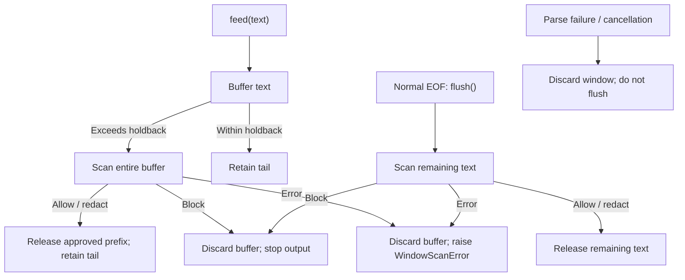

# KAITO Guardrail Core

`kaito-guardrail-core` provides KAITO-owned scanners and standard-library-only
streaming utilities. `guardrail_core.streaming.sse` and
`guardrail_core.streaming.openai` frame SSE events and parse/build OpenAI chat
chunks; they do not scan or enforce policy.

`guardrail_core.streaming.window` provides a policy-independent text window for
scan-before-release buffering.

## Scanner configuration (0.2.0)

`guardrail_core.config` exposes the scanner schemas previously available only in
RAGEngine, along with `parse_scanner_config()` and `build_scanner()`. Applications
own policy loading and failure handling; they must not recreate a scanner registry.

```python
from guardrail_core.config import build_scanner, parse_scanner_config

config = parse_scanner_config(
    {"type": "ban_substrings", "substrings": ["secret"], "action": "redact"}
)
scanner = build_scanner(config)
result = scanner.scan("", "a secret")
assert result.output == "a [REDACTED]"
```

Entries use a flattened mapping with `type`, optional `action` (`block` or
`redact`), and scanner-specific fields. The default action is `block`. Type and
field names accept snake_case, camelCase, and hyphenated spelling, matching
RAGEngine's policy convention. Scanner order and policy-level actions remain the
caller's responsibility.

The strict parser rejects unknown scanners, unknown or duplicate normalized
fields, invalid actions, and malformed scanner settings with `ValueError`.
It does not log and skip invalid entries. Construction exceptions from
`build_scanner()` propagate unchanged. The schema classes retain their existing
`from_dict()` and `build()` methods.

Configuration and construction stay in `guardrail_core.config`; sensitive-data
detection and redaction live in an internal scanner module. Consumers continue
to use the same configuration APIs.

RAGEngine remains pinned to the published 0.1.1 package and retains its existing
schemas until 0.2.0 is released. Migrating its imports is a subsequent change;
this avoids making RAGEngine depend on an unpublished package. The 0.2.0 source
and wheel can be tested before publishing; the version bump is not a release.

## Installation and development

Install the published package:

```sh
python -m pip install kaito-guardrail-core
```

For local development:

```sh
python -m pip install -e ./guardrail_core
python -m pip install build==1.2.2.post1 twine==6.1.0 pytest==9.1.1
python -m build ./guardrail_core
python -m twine check --strict guardrail_core/dist/*
python -m pytest guardrail_core/tests guardrail_core/guardrail_core
```

CI tests the installed wheel outside the source tree in a fresh environment on
Python 3.12 through 3.14. The distribution name is `kaito-guardrail-core`;
Python imports use `guardrail_core`.

## Streaming window

`guardrail_core.streaming.window` retains output tails to detect cross-chunk
matches, releasing only scanner-approved prefixes.

`holdback_len` is measured in Unicode code points and must be sufficient for the
scanner's cross-chunk matching requirements.



Example (prints `hello world`; replace `print` with downstream emission):

```python
from guardrail_core.streaming.window import (
    StreamingBufferWindow,
    WindowScanError,
    WindowScanResult,
)


class Scanner:
    def scan(
        self, text: str, *, flush: bool = False, preceding_char: str = ""
    ) -> WindowScanResult:
        return WindowScanResult(blocked="secret" in text)


window = StreamingBufferWindow(Scanner(), holdback_len=len("secret") - 1)
chunks = ["hello ", "world"]

try:
    for text in chunks:
        result = window.feed(text)
        print("".join(result.chunks), end="")
        if result.blocked:
            print("[blocked]")
            break
    else:
        result = window.flush()
        print("[blocked]" if result.blocked else "".join(result.chunks), end="")
except WindowScanError:
    print("[scan failed]")
```

Use `chunks = ["safe se", "cret"]` to exercise cross-chunk blocking. Parse errors
and cancellation must propagate without entering the normal-EOF `else` branch.

`Scanner` is illustrative; replace it with your scanner adapter. The caller is
responsible for closing the upstream stream and generating product-specific
refusal responses.

## Byte-oriented SSE framing

```python
from guardrail_core.streaming.sse import SSEFramer
from guardrail_core.streaming.openai import parse_openai_chat_sse_event

framer = SSEFramer(max_event_bytes=1024 * 1024)
for chunk in [b'data: {"choices":[]}\r', b"\n\r", b"\n"]:
    for event in framer.feed(chunk):
        result = parse_openai_chat_sse_event(event)
        print(result.status, result.payload)
for event in framer.finish():
    print(event.data)
```

Call `feed(bytes)` in stream order and `finish()` exactly once at EOF. Both return
lists of complete `SSEEvent` objects. LF, CRLF, CR, mixed endings, and arbitrary
byte boundaries are supported. Complete events use strict UTF-8 decoding.
EOF never supplies a missing event terminator.

- `event.raw_bytes`: exact received bytes, **including** line endings and the
  terminating blank line, suitable for lossless forwarding.
- `event.raw`: decoded event body, excluding its final line ending and blank line.
- `event.lines`: body lines, including comments and non-data fields.
- `event.data`: joined data fields, or `None` when no data fields exist.
- `SSEEvent.from_raw(text)`: parse an already decoded event **body**, without
  framing; its `raw_bytes` defaults to the UTF-8 encoding of that body.

### Errors and resource bounds

`SSEFramingError` is a `ValueError` with these subclasses:

| Exception | Meaning |
| --- | --- |
| `SSEDecodeError` | A complete event is not valid UTF-8; the original decode error is chained. |
| `SSEIncompleteEventError` | EOF left an unterminated event, including an incomplete UTF-8 sequence. |
| `SSEEventTooLargeError` | An event exceeded `max_event_bytes` (default 1 MiB). |

`max_event_bytes` must be a positive integer and counts wire bytes, including
delimiters, per event. Invalid limits and non-byte input raise `ValueError`/`TypeError`.

On failure, `error.raw_bytes` contains the failing event's buffered bytes (at most
the limit); `error.completed_events` retains earlier complete events from the same
call. Callers choose whether to forward them and how to handle failure.
After a framing error or `finish()`, the framer is unusable; further calls raise
`ValueError`.

## OpenAI parsing contract

`parse_openai_chat_sse_event(event)` returns `OpenAIChatChunkParseResult`, retaining
RAGEngine's status names and convenience fields:

| Input | `OpenAIChatChunkParseStatus` |
| --- | --- |
| No data field, empty data, or whitespace-only data | `NO_DATA` |
| Data equal to `[DONE]` after stripping whitespace | `DONE` |
| Invalid JSON | `MALFORMED_JSON`, with `error` |
| Non-object payload, non-list choices, or non-object choice | `INVALID_PAYLOAD`, with `error` |
| Missing/non-integer choice index (including bool) | `INVALID_PAYLOAD`, with `error` |
| Missing/null delta | `PARSED`, treating delta as an empty object |
| Non-object, non-null delta | `INVALID_PAYLOAD`, with `error` |
| Missing/null content | `PARSED`, no text |
| Non-string, non-null content or finish_reason | `INVALID_PAYLOAD`, with `error` |
| Missing `choices` | `PARSED`, treating choices as an empty list |
| Valid choices, including empty, role-only, and multi-choice chunks | `PARSED` |

All choices are retained in order, including role-only and tool-call-only chunks;
indexes need not be zero or contiguous. Use `parsed_choices` for aligned content
and finish reasons, not the filtered `contents`/`finish_reasons` lists.
`payload` preserves the original fields, including invalid object payloads.

## SSE builders

The functions in `guardrail_core.streaming.openai` return UTF-8-encodable strings
with LF delimiters, matching RAGEngine:

- `build_openai_chat_delta_sse_chunk(content, *, choice_index=0)`
- `build_openai_chat_finish_reason_sse_chunk(*, finish_reason="content_filter", choice_index=0)`
- `build_sse_done_chunk()`
- `build_sse_data_chunk(payload)` for arbitrary JSON object fields and choices

Text builders create new minimal chunks; use the generic builder with a retained
payload to preserve metadata, or forward `event.raw_bytes` for byte-exact replay.

## Publishing

Build only `guardrail_core/`, using `pyproject.toml` for metadata and version.
Wheels exclude tests; source distributions include tests and build inputs.

### Publisher setup

Confirm maintainer access and configure:

- A project or pending publisher on both TestPyPI and PyPI for `kaito-guardrail-core`.
- A GitHub Trusted Publisher on each index: owner `kaito-project`, repository
  `kaito`, workflow filename `release-guardrail-core.yaml`, and the corresponding
  GitHub environment below. Publishing uses GitHub OIDC, not an API token.
- GitHub environments `guardrail-core-testpypi` and `guardrail-core-pypi`, restricted
  to `main`. Require maintainer approval for `guardrail-core-pypi` before enabling
  production publishing.

### Release workflow

After the intended package version merges into `main`, run the
[Release KAITO Guardrail Core workflow](../.github/workflows/release-guardrail-core.yaml):

1. Select `main`. Set `release_version` to the metadata version and `release_commit`
   to its full lowercase 40-character SHA on `main`; the package tag must not exist.
2. Build and validate the source distribution and wheel; test the installed wheel
   outside the source checkout.
3. Publish to TestPyPI and verify the downloaded wheel byte-for-byte. Install its
   dependencies separately from PyPI; do not mix indexes.
4. Approve `guardrail-core-pypi`, then publish the same stored artifacts to PyPI
   without rebuilding.
5. Create `kaito-guardrail-core-v<version>` and a GitHub Release for that source
   commit, attaching the artifacts. Do not mark it as the repository's latest release.

### Recovery

For transient failures, rerun only failed jobs in the same run to reuse artifacts.
Never overwrite an existing version or rebuild different content under it.
Coordinate partial-upload recovery with maintainers; bump the version in a new PR
before the next release.

### Consumer adoption

Consumers must pin a version already published on production PyPI. Production
images install requirements, not library source; editable installs are for development.
